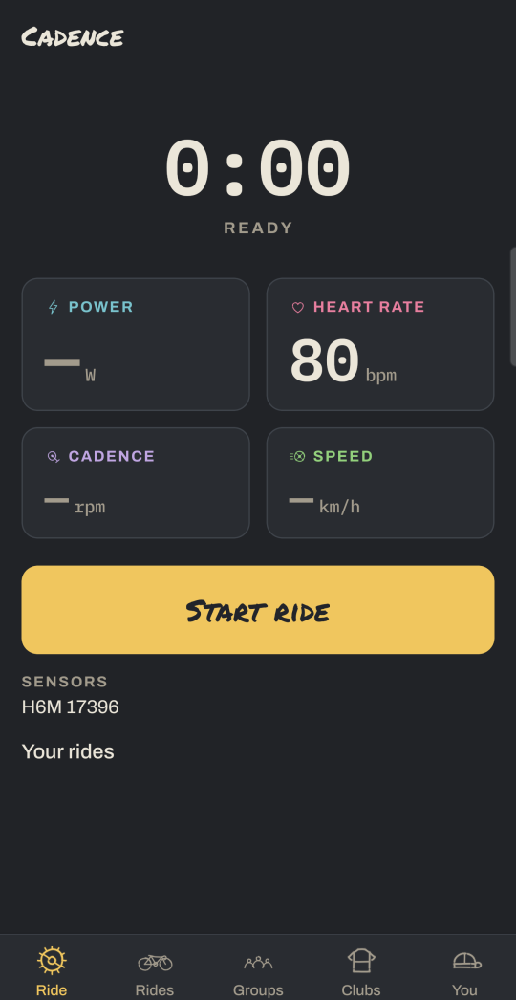
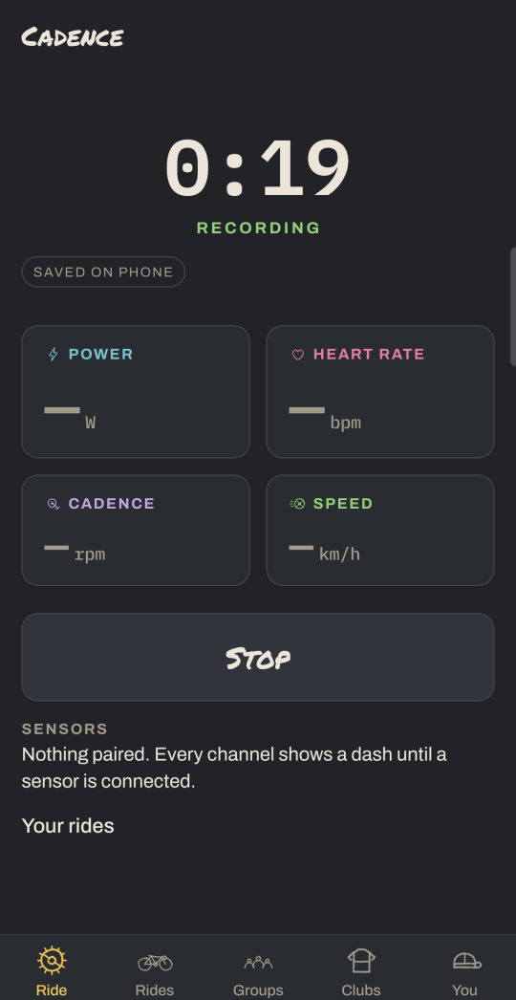

# Cafe Ride

**Live telemetry and group riding for cyclists.** The phone is the head unit: it pairs straight to
Bluetooth heart-rate and power sensors, records the ride, and streams heart rate, power, cadence,
speed and position to a private link *while the ride is happening*. The same samples become the
stored ride for analysis afterwards.

> This is a progress showcase. The source code is private; this repo holds the write-up,
> screenshots and a changelog of what has been built.

## Why it exists

No product covers both halves of a ride:

- **Strava and intervals.icu** analyse a ride in depth, but only after it's over. Nothing is live.
- **Garmin LiveTrack** shows a live map, but it's a closed widget tied to Garmin hardware. It has no
  power or heart-rate depth and no way to share selectively.

Cafe Ride covers both. A coach can watch your power during an interval session, a partner can follow
a long solo ride, and a group can see who is on the front. Afterwards the ride is already in your
history, with no second app or file export.

## Who it's for

Riders who already train with data and already ride with other people:

1. **Someone watching.** A partner following a long ride, or a coach watching a session live.
2. **A group ride.** Everyone's telemetry in one view: who is on the front, how strung out the bunch
   is, and who did the work.
3. **Afterwards.** A ride list and ride detail built from the same samples.

## Screenshots

Taken on an Android phone during on-device testing. They predate the rename, so the app still says
"Cadence" in places.

| Ready to ride | Recording | Your rides | Group rides |
|---|---|---|---|
|  |  |  |  |

The interface is drawn as **chalk on a road surface**: hand-lettered headings, sketched frames and
one colour per rider. The phone and the web app share a single design system.

## What's built

| Area | Status |
|---|---|
| Phone recorder: BLE sensor pairing, GPS, background recording | Built; running on a real Android phone |
| Live pipeline: phone → server → viewers, with outage backfill | Built |
| Private share links, privacy zones, per-channel visibility | Built |
| Group rides: live map, who is on the front, replay, highlights | Built |
| Clubs, "Join Me" open rides, profile pictures | Built |
| FIT and GPX import | Built |
| Ride analysis: summaries, weighted power, group highlights | v1 |
| Web app: viewer, history, group rides, clubs, light/dark | Built |
| Self-hosted chalk-style basemap, shared by web and phone | Built |
| Strava import | Deferred: API terms need reading first |
| Production deployment | Not started |

More than 500 automated tests cover the work. A ride simulator replays rides through the real
recording pipeline, so live features can be built and demonstrated without a bike.

## Tech stack

- **Phone:** React Native with Expo 54, React 19, Bluetooth LE and background location
- **Web:** Next.js and React 19, MapLibre with a self-hosted vector basemap (PMTiles)
- **Server:** Node.js and Fastify, WebSocket ingest, Server-Sent Events fan-out
- **Data:** PostgreSQL / TimescaleDB, with PGlite (in-process Postgres) for development and tests
- **Shared:** TypeScript monorepo; sensor parsing, analytics and the design system are pure
  packages shared by every client

## Design decisions

- **Privacy is a feature, not a setting.** The product publishes people's live locations. Share
  links are unguessable and stored hashed, positions are clipped near home, hidden channels are left
  out of the data rather than hidden in the UI, and a revoked link returns "not found" so it doesn't
  confirm it ever existed.
- **The web doesn't record.** Web Bluetooth is Chrome-only and can't keep a connection with the
  screen off. Recording is the phone's job; the web handles watching, analysis and sharing.
- **The live slice shipped end to end first.** Recording, streaming and watching worked whole before
  breadth was added.
- **Testable at a desk.** Sensor parsing and metrics are pure functions, and a simulator replays rides
  through the real pipeline, so most of the work needs no sensors and no bike.

## Progress

See [CHANGELOG.md](CHANGELOG.md) for what changed, day by day.
