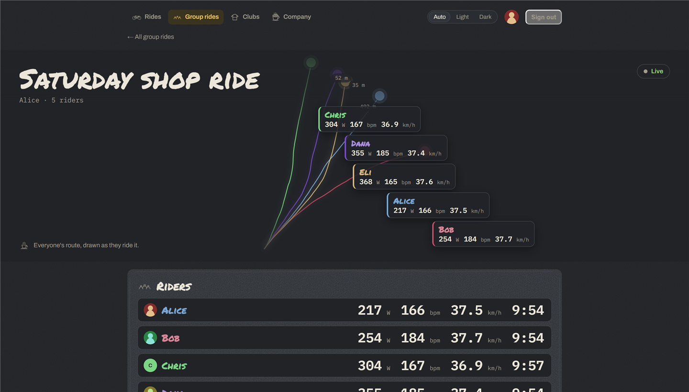
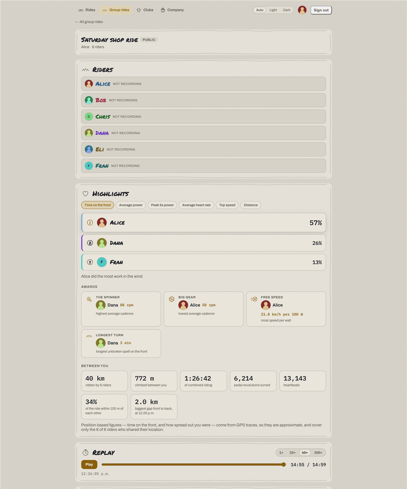
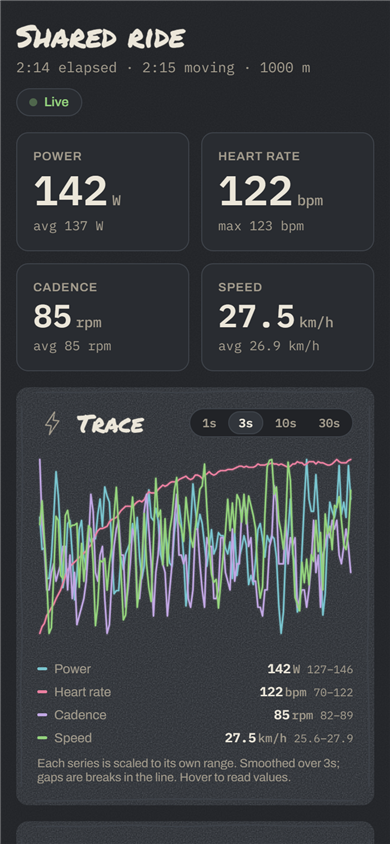
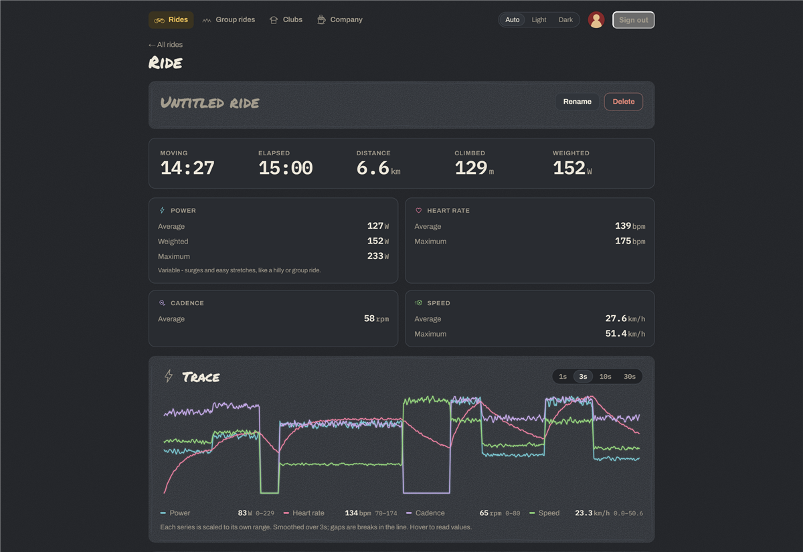
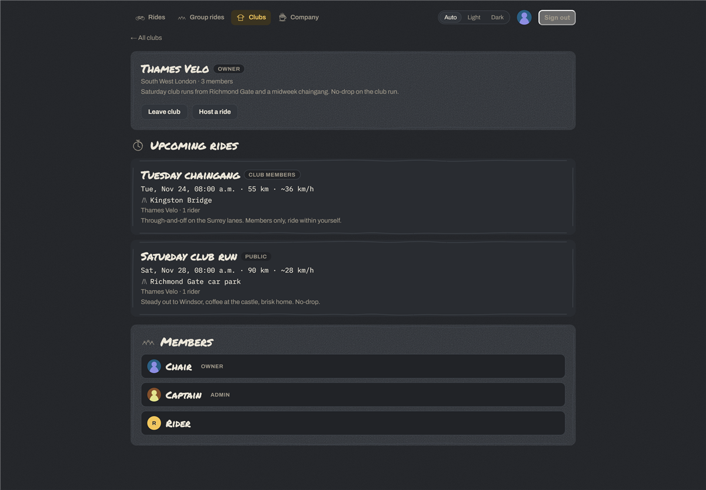
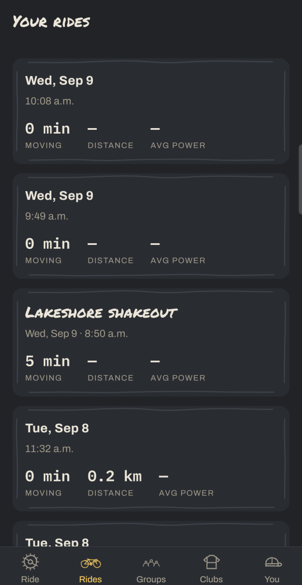
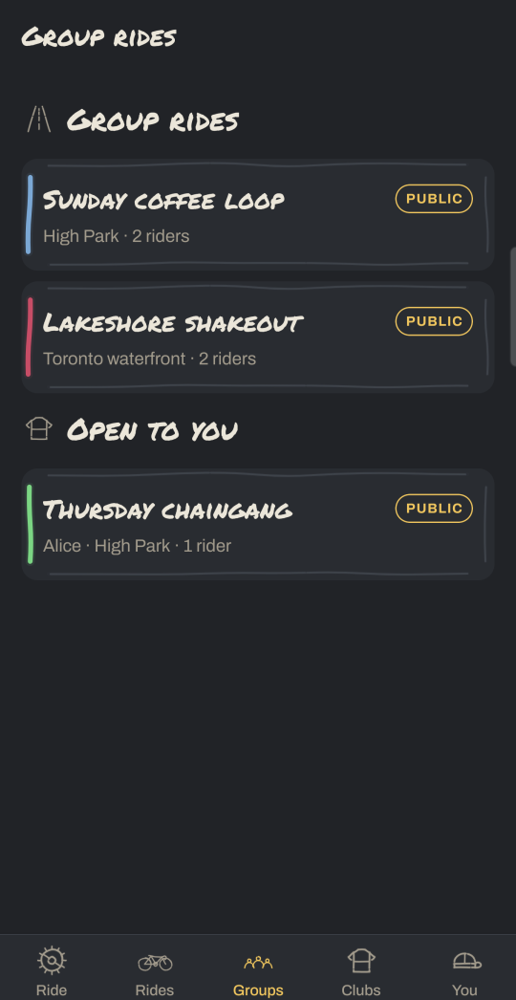

# Cafe Ride

Cafe Ride is a cycling app I'm building that turns your phone into the head unit. It connects to
your heart rate strap and power meter over Bluetooth, records the ride, and streams it live to a
private link, so someone at home or a coach can follow along while you ride. When you finish, the
ride is saved and ready to look back on.

The code lives in a private repo. This one is where I post screenshots and progress.

## Why I'm building it

Strava and intervals.icu are great for digging into a ride after it's done, but neither shows
anything while you're out there. Garmin LiveTrack does show a live map, but only from Garmin
devices, and it doesn't tell the person watching much beyond where you are.

I wanted both in one app: watch a ride as it happens, power and heart rate included, then have the
same ride in your history afterwards. Group rides were the other big reason. I want to see the whole
group on one map, who's pulling on the front and how spread out everyone is, and then go through it
over coffee.

## Screenshots

The look is meant to be chalk on a road. Headings are hand-lettered, panels are sketched, and every
rider gets their own colour. The web app and the phone share the same design, with light and dark
themes.

### Web

These use demo riders, sent through the real backend by a ride simulator I wrote. Map tiles were
turned off when I took them, so the routes are drawn on a plain background.

A group ride while it's happening. Each rider's route draws in as they go, with their numbers next
to them on the map.

After the ride you get highlights: who spent the most time on the front, a few awards, totals for
the group, and a replay of the whole ride. This one is in the light theme.

| Landing page | Following a ride live on a phone |
|---|---|
|  |  |

| A finished ride | A club page |
|---|---|
|  |  |

### Phone

These are from testing on my Android phone. I took them before renaming the app, so some still say
"Cadence".

| Ready to ride | Recording | Ride history | Group rides |
|---|---|---|---|
|  |  |  |  |

## Where it's at

Working now:

- Recording on the phone with Bluetooth sensors and GPS, including with the screen off
- Live streaming to a share link, with gaps filled in when you lose signal
- Choosing what a link shows, and hiding your position near home
- Group rides with a live map, who's on the front, replay and highlights
- Clubs, open rides others can join, and profile pictures
- Importing FIT and GPX files
- Basic ride analysis: averages, weighted power, group stats
- A map style I host myself, used by both the web app and the phone

Still to do:

- Strava import (I need to read their API terms properly first)
- Putting it on a real server. It only runs locally for now.

There are a little over 500 automated tests. Most of the project can be tested without a bike,
since the simulator replays rides through the same code the phone uses.

## Built with

- Phone: React Native and Expo
- Web: Next.js and MapLibre
- Server: Node.js and Fastify, with WebSockets for incoming rides and Server-Sent Events to viewers
- Database: PostgreSQL and TimescaleDB. Locally and in tests it uses PGlite, so no setup is needed.
- Everything is TypeScript in one monorepo, and the web app and the phone share code where they can.

## Things I decided early on

Privacy comes first. The app shares where people are in real time, so share links can't be guessed
and are stored hashed, and positions close to home are cut off. A link that's been revoked looks
exactly like one that never existed.

Only the phone records. The web can talk to Bluetooth sensors, but only in Chrome, and the
connection drops once the screen turns off, which doesn't work on a ride. The web app is for
watching, looking back and sharing.

I built the live part all the way through first, from recording to streaming to watching, before
adding anything else.

## Progress

[CHANGELOG.md](CHANGELOG.md) has what changed each day.
